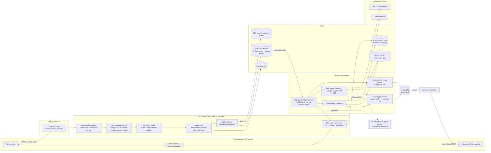

# ADR 0075: B2B Distribution API (machine partners, multi-supplier fan-out, outbound webhooks)

## Status
Proposed. This change ships four pieces, listed under "Built in this change". Everything else here is a design to
review and **must not be presented as a production capability** (invariant 10). No route serves the distribution API yet,
and no migration is included.

## Context
fBeds distributes inventory to agencies through the agent portal: a browser, an opaque session cookie (ADR 0001), one
`SUPPLIER_ADAPTER`. Agency systems and OTAs now need a machine API: search, re-confirm, book over REST/JSON, with
downstream webhooks. The request also asked for supplier aggregation, circuit breakers, Redis caching, row-locked
booking and request tracing.

Most of that already exists. This ADR builds on it rather than replacing it:

| Requirement | Already in the repository | Gap |
| --- | --- | --- |
| API key / OAuth2, per-agency quotas | Session auth, RBAC permissions per controller (ADR 0068), login throttle (ADR 0062), edge protection (ADR 0056) | **No machine credential, no per-client quota** |
| Unified JSON schema | `ApiEnvelope`, `AgentSearchResponse` (portal-shaped) | **No partner contract** (built here, proposed) |
| Supplier adapters | `SupplierAdapter` port, XML connector kit with hardened transport and `ConnectorGate` circuit breaker (ADR 0060), Hotelbeds JSON evaluation client | **One adapter only, no fan-out** (primitive built here); shared Redis gate (ADR 0060 go-live prerequisite) |
| Caching | Redis connection reuse, `CacheAside` for static content, 15-45 s single-flight search cache (ADR 0009, 0064) | Content cache per language, geo index |
| CheckRate -> Book | `rates/recheck`, `offers/:id/hold`, `prebook`, `bookings`; `BookingConfirmationService` locks Booking -> InventoryHold -> Wallet with `SELECT ... FOR UPDATE` and settles the ledger HOLD as RELEASE + DEBIT in one transaction (ADR 0062, 0068) | None for the core; partner routes are a thin façade |
| Correlation ids | `RequestIdMiddleware`, supplier `correlationId`, `ConnectorExecution`, sanitized `TransportEvent` | **Caller id was trusted verbatim** (fixed here) |
| Webhooks | Inbound supplier webhooks only; transactional outbox pattern (`BookingEmail`, ADR 0066) | **No outbound partner webhooks** |

## Architecture

### Request lifecycle (search)



### Two-step booking (CheckRate -> Book)

```mermaid
sequenceDiagram
  autonumber
  participant P as Partner
  participant G as Gateway (auth, quota, idempotency)
  participant S as Booking services (existing)
  participant SUP as Supplier connector
  participant DB as PostgreSQL

  P->>G: POST /distribution/v1/check-rate {offerId}<br/>Idempotency-Key
  G->>S: recheck(offer)
  S->>SUP: live recheck (read, may retry once)
  SUP-->>S: price + real expiry, or unavailable
  S->>DB: InventoryHold (unique tenant + idempotencyKey), nights held
  S->>DB: ledger HOLD on agency wallet (credit check under wallet FOR UPDATE)
  S-->>P: {holdId, total, expiresAt, priceChanged}
  P->>G: POST /distribution/v1/bookings {holdId, guests}<br/>Idempotency-Key
  G->>S: prebook (supplier mutation, never retried)
  S->>SUP: book
  alt answered
    SUP-->>S: confirmed / refused
  else timeout (maybe_sent)
    S->>SUP: statusByReference before concluding
  end
  S->>DB: BEGIN; Booking FOR UPDATE -> InventoryHold FOR UPDATE -> Wallet FOR UPDATE
  S->>DB: nights held -> sold; ledger RELEASE + DEBIT; booking CONFIRMED; audit; webhook outbox row; COMMIT
  S-->>P: {bookingId, reference, status}
  Note over DB,P: Webhook dispatcher delivers booking.confirmed later, HMAC-signed, retried with backoff
```

The lock order **Booking -> InventoryHold -> Wallet** is the one `BookingConfirmationService` takes; the cancellation
settlement takes Booking -> Wallet, a prefix of it. Any new path that touches more than one of them must take them in this order, or two
transactions can deadlock.

## Decision

### 1. Gateway and authentication
- **Credentials.** A `DistributionClient` belongs to one tenant and one agency. It authenticates either with an API key
  (`fbk_live_<keyId>_<secret>`, 32 random bytes) sent as `Authorization: ApiKey ...`, or with OAuth2
  `client_credentials` at `POST /distribution/v1/oauth/token`, which returns an opaque bearer token valid 15 minutes.
  Opaque, not JWT, for the reasons in ADR 0001: revocation is a row update. Only SHA-256 hashes of the secret and of
  the token are stored (high-entropy secrets, so a fast hash is correct here; ADR 0002 bcrypt is for human passwords).
  Lookup is by `keyId`, then a constant-time hash comparison.
- **Identity.** The guard sets the same tenant context the portal uses (`withTenant`, forced RLS). Tenant and agency
  come from the credential only; the Zod schemas are strict and reject `tenantId`/`agencyId` in a body (invariant 1).
- **Authorization.** Scopes on the client map one to one onto the existing permissions: `search -> hotel.search`,
  `checkrate -> booking.prebook`, `book -> booking.create`, `cancel -> booking.cancel`, `bookings:read -> booking.read`.
  Every distribution controller declares its permission (invariant 2, ADR 0068). A suspended agency (ADR 0020)
  disables all of its clients.
- **Quotas.** A Redis token bucket per client and scope class (search, check-rate, book), limits on the client row,
  `429 QUOTA_EXCEEDED` with `Retry-After` and `RateLimit-*` headers. Book quotas are separate so a search storm cannot
  starve bookings. If Redis is unavailable the guard falls back to an in-process bucket at `limit / API task count`:
  stricter, never open. Volumetric DDoS stays at the edge (ADR 0056); quotas address scraping and runaway integrations.
  A look-to-book ratio per client is reported, not enforced, in the first release.
- **Optional IP allowlist** per client (CIDR list), checked after authentication.

### 2. Supplier integration and normalization
- Every supplier stays behind the `SupplierAdapter` port and its connector profile; provider types never leave the
  connector package (invariant 9).
- An `AggregatingSupplierAdapter` (API, not built) implements `search` with `fanOutRead` (built here): one leg per
  ready supplier (`evaluateReadiness`), per-leg timeout (default 6 s) capped by an overall deadline (default 8 s), each
  leg guarded by that supplier's `ConnectorGate`. `recheck`, `prebook` and `cancel` are **not** fanned out: they go to
  the one supplier that owns the offer, through the existing transport, where mutations are never retried.
- **Fallback policy (invariant 5).** A failed search leg contributes nothing and is counted. The response says
  `suppliers.complete = false`, so a partner never reads a partial answer as "no availability". A fallback is allowed
  only where a caller declares it per leg, it is tagged `fallback`, and it is reserved for static content (last
  published description and images). Rates, availability and prices never have a fallback.
- **Circuit breaker.** `InProcessGate` is per process. Before more than one API task calls a live supplier, a Redis
  `ConnectorGate` (shared failure count and open-until per supplier credential, `INCR` + `PEXPIRE`) replaces it, as
  ADR 0060 already requires. Resilience4j is a JVM library; the gate plus `fanOutRead` provide the same breaker,
  bulkhead and time limiter in Node.

### 3. Caching and search shaping
| Tier | Key | TTL | Rule |
| --- | --- | --- | --- |
| Static content | `fbeds:v1:<tenant>:content:<hotelId>:<lang>` | 24 h, jittered | `CacheAside` (ADR 0064); invalidated on hotel publication; may be the declared fallback |
| Geo index | `fbeds:v1:<tenant>:geo:published` (Redis GEO) | rebuilt on publication | `GEOSEARCH BYBOX` gives candidate ids; each id is re-checked against the published catalogue before use |
| Search results | `fbeds:v1:<tenant>:<agency>:search:<sha256(canonical criteria)>` | 15-45 s | Existing ADR 0009 cache, now agency-keyed because markup and distribution restrictions differ per agency; single-flight |
| Supplier observations | none in Postgres | - | Not persisted. An observation is never selectable without a live CheckRate that returns a real expiry |

Filtering (stars, board basis, refundable, max total, bounding box), sorting and pagination run in the gateway over
the merged, priced result for that search. The cursor is an HMAC-signed `{searchId, offset, sort, clientId}`, so it
cannot be replayed by another client or edited to skip the window.

### 4. Booking, holds and money
No new booking core. Distribution routes are a façade over the existing services and keep their guarantees: the
`Idempotency-Key` header becomes the hold and booking idempotency key (unique per tenant); credit is authorized as a
ledger HOLD and settled as RELEASE + DEBIT inside the confirmation transaction; holds expire through the sweeper
(ADR 0005). Money is integer minor units, exposed to partners as decimal strings (`DistributionMoney`).

### 5. Outbound webhooks
Transactional outbox, as for confirmation emails (ADR 0066): the `WebhookDelivery` row is written in the same
transaction as the booking change, or not at all. A dispatcher claims rows with `FOR UPDATE SKIP LOCKED`, POSTs with
`X-Fbeds-Signature: t=<unix>,v1=<hmac-sha256(secret, t + "." + body)>` and a stable `X-Fbeds-Event-Id` so the receiver
can deduplicate, and retries with exponential backoff for 24 hours. The endpoint is validated like a supplier endpoint
(https, public DNS, no redirects). The payload carries event type, booking id, reference and status, **no guest data**:
the partner fetches details through the authenticated API (invariant 7).

### 6. Tracing and logging
- `X-Request-ID` is accepted only if it is 8-128 characters of `[A-Za-z0-9._:-]`; anything else is replaced by a UUID
  (built here). It is echoed on every response and becomes the supplier `correlationId` and the `ConnectorExecution`
  key.
- One structured JSON line per supplier leg and per transport attempt (`FanoutLegEvent`, `TransportEvent`): ids, error
  code, attempt, duration, HTTP status. Booking rollbacks log the booking id, stage and error class.
- **Failed supplier payloads are not logged** (invariant 7: they carry guest PII and rate keys). A failure is recorded
  by classification code, response size and SHA-256 of the body. If a supplier dispute needs the raw body, that is a
  separate encrypted, access-controlled, short-retention store with its own ADR, off by default.

Example line:
```json
{"event":"supplier_leg","operation":"search","supplierId":"sup_webbeds","connectorId":"con_wb_1","correlationId":"partner-req.2027:0001","outcome":"timeout","fallbackUsed":false,"durationMs":6001}
```

### 7. Proposed schema (not applied)
The snippet below needs a reviewed migration with RLS policies before it is used. Rate and availability caches are
deliberately **not** in it: they live in Redis with short TTLs, and the supplier-to-canonical mapping already exists
(`SupplierHotelMapping`, ADR 0004, 0059). Holds and bookings already exist (`InventoryHold`, `InventoryHoldNight`,
`Booking`, `Wallet`, `LedgerEntry`); the only change to them is attribution.

```prisma
enum DistributionClientStatus { ACTIVE SUSPENDED REVOKED }
enum DistributionCredentialKind { API_KEY OAUTH_CLIENT }
enum WebhookDeliveryStatus { QUEUED SENDING DELIVERED RETRY_WAIT FAILED }

/// A partner system acting for one agency. Tenant and agency are fixed at creation.
model DistributionClient {
  id                 String                   @id @default(cuid())
  tenantId           String                   @map("tenant_id")
  agencyId           String                   @map("agency_id")
  agency             Agency                   @relation(fields: [tenantId, agencyId], references: [tenantId, id], onDelete: Restrict)
  name               String
  status             DistributionClientStatus @default(ACTIVE)
  /// Subset of: search, checkrate, book, cancel, bookings:read.
  scopes             String[]
  /// Requests per minute per scope class; integers, enforced in Redis.
  searchPerMinute    Int                      @default(120) @map("search_per_minute")
  checkRatePerMinute Int                      @default(30)  @map("check_rate_per_minute")
  bookPerMinute      Int                      @default(10)  @map("book_per_minute")
  ipAllowlist        String[]                 @map("ip_allowlist")
  createdById        String                   @map("created_by_id")
  createdAt          DateTime                 @default(now()) @map("created_at")
  updatedAt          DateTime                 @updatedAt @map("updated_at")
  credentials        DistributionCredential[]
  accessTokens       DistributionAccessToken[]
  webhooks           WebhookSubscription[]
  bookings           Booking[]

  @@unique([tenantId, id])
  @@index([tenantId, agencyId, status])
}

/// API key or OAuth client secret. Only the SHA-256 hash is stored; the secret is shown once at creation.
model DistributionCredential {
  id         String                     @id @default(cuid())
  tenantId   String                     @map("tenant_id")
  clientId   String                     @map("client_id")
  client     DistributionClient         @relation(fields: [tenantId, clientId], references: [tenantId, id], onDelete: Cascade)
  kind       DistributionCredentialKind
  /// Public lookup id embedded in the key, globally unique so the guard can resolve it before tenant context exists.
  keyId      String                     @unique @map("key_id")
  secretHash String                     @map("secret_hash") @db.Char(64)
  lastUsedAt DateTime?                  @map("last_used_at")
  expiresAt  DateTime?                  @map("expires_at")
  revokedAt  DateTime?                  @map("revoked_at")
  createdAt  DateTime                   @default(now()) @map("created_at")

  @@index([tenantId, clientId])
}

/// Opaque OAuth2 access token (client_credentials), 15 minutes.
model DistributionAccessToken {
  id        String             @id @default(cuid())
  tenantId  String             @map("tenant_id")
  clientId  String             @map("client_id")
  client    DistributionClient @relation(fields: [tenantId, clientId], references: [tenantId, id], onDelete: Cascade)
  tokenHash String             @unique @map("token_hash") @db.Char(64)
  scopes    String[]
  expiresAt DateTime           @map("expires_at")
  revokedAt DateTime?          @map("revoked_at")
  createdAt DateTime           @default(now()) @map("created_at")

  @@index([tenantId, expiresAt])
}

model WebhookSubscription {
  id         String             @id @default(cuid())
  tenantId   String             @map("tenant_id")
  clientId   String             @map("client_id")
  client     DistributionClient @relation(fields: [tenantId, clientId], references: [tenantId, id], onDelete: Cascade)
  url        String
  /// booking.confirmed, booking.cancelled, booking.amended, hold.expired
  events     String[]
  /// Secret-manager reference for the HMAC key, never the key (invariant 7).
  secretRef  String             @map("secret_ref")
  active     Boolean            @default(true)
  createdAt  DateTime           @default(now()) @map("created_at")
  updatedAt  DateTime           @updatedAt @map("updated_at")
  deliveries WebhookDelivery[]

  @@unique([tenantId, id])
  @@index([tenantId, clientId, active])
}

/// Outbox row written in the same transaction as the booking change it reports.
model WebhookDelivery {
  id             String                @id @default(cuid())
  tenantId       String                @map("tenant_id")
  subscriptionId String                @map("subscription_id")
  subscription   WebhookSubscription   @relation(fields: [tenantId, subscriptionId], references: [tenantId, id], onDelete: Restrict)
  /// Stable event id sent as X-Fbeds-Event-Id; the receiver deduplicates on it.
  eventId        String                @map("event_id")
  eventType      String                @map("event_type")
  bookingId      String?               @map("booking_id")
  /// Event type, ids, reference and status only. No guest data.
  payload        Json
  status         WebhookDeliveryStatus @default(QUEUED)
  attempts       Int                   @default(0)
  runAfter       DateTime              @default(now()) @map("run_after")
  lockedUntil    DateTime?             @map("locked_until")
  lastHttpStatus Int?                  @map("last_http_status")
  lastErrorCode  String?               @map("last_error_code")
  deliveredAt    DateTime?             @map("delivered_at")
  createdAt      DateTime              @default(now()) @map("created_at")

  @@unique([tenantId, subscriptionId, eventId])
  @@index([tenantId, status, runAfter])
}

// Booking gains attribution only:
//   distributionClientId String? @map("distribution_client_id")
//   distributionClient   DistributionClient? @relation(fields: [tenantId, distributionClientId], references: [tenantId, id], onDelete: Restrict)
//   @@index([tenantId, distributionClientId, createdAt])
```

**Tenant-index review.** Every table carries `tenant_id`, every relation is composite on `(tenant_id, id)` so a row
cannot point into another tenant, and every list path leads with `tenant_id`. Two lookups run before tenant context
exists and are global by design: `DistributionCredential.keyId` and `DistributionAccessToken.tokenHash`. They need a
narrow `SECURITY DEFINER` resolver (as the booking job migrations already use) that returns only
`(tenant_id, client_id, status)` for one exact key; RLS stays forced on both tables for every other read.

**Migration rollback.** Additive only: new enums, five new tables, one nullable column and index on `Booking`. Rollback
drops the `Booking` column and index, then the five tables and three enums, after confirming no `WebhookDelivery` row
is `QUEUED`/`SENDING`.

## Built in this change
1. `fanOutRead` in `@bedbanks/connectors-core` (`src/fanout/supplier-fanout.ts`) with 12 tests: per-leg and overall
   deadlines that hold even when a supplier ignores its abort signal, circuit gate integration, declared-only and tagged
   fallbacks, caller cancellation that neither trips the breaker nor runs fallbacks, read-only enforcement, sanitized
   events. Not wired to any route.
2. `DistributionSearchRequest` / `DistributionSearchResponse` in `@bedbanks/contracts` (proposed, no route).
3. `distributionSearchRequestSchema` in `@bedbanks/validation`, with a compile-time check that the schema and the
   contract are the same type, and 9 tests.
4. `RequestIdMiddleware` validates a caller-supplied `X-Request-ID` before it reaches logs, audit payloads and
   supplier correlation ids.

## Not built (do not present as capability)
- Distribution routes, `DistributionAuthGuard`, quota guard, OAuth token endpoint, admin screens for clients and keys.
- `AggregatingSupplierAdapter` and the Redis `ConnectorGate`.
- Agency-keyed search cache, content cache per language, geo index.
- Webhook subscription API, outbox writes, dispatcher.
- The schema above and its migration.

Suggested order: Redis gate, then aggregator behind the existing portal search (measurable without partners), then
client credentials and quotas, then partner search, CheckRate and Book routes, then webhooks.

## Rollback (this change)
Revert the commit. No schema, permission or route change. The request-id change only narrows which caller ids are
reused; callers that send a safe id are unaffected.

## Verification
`pnpm check:architecture`; `@bedbanks/connectors-core`, `@bedbanks/validation` and `@bedbanks/contracts` type-check,
lint and test; API unit tests for the request-id middleware and the exception filter.
